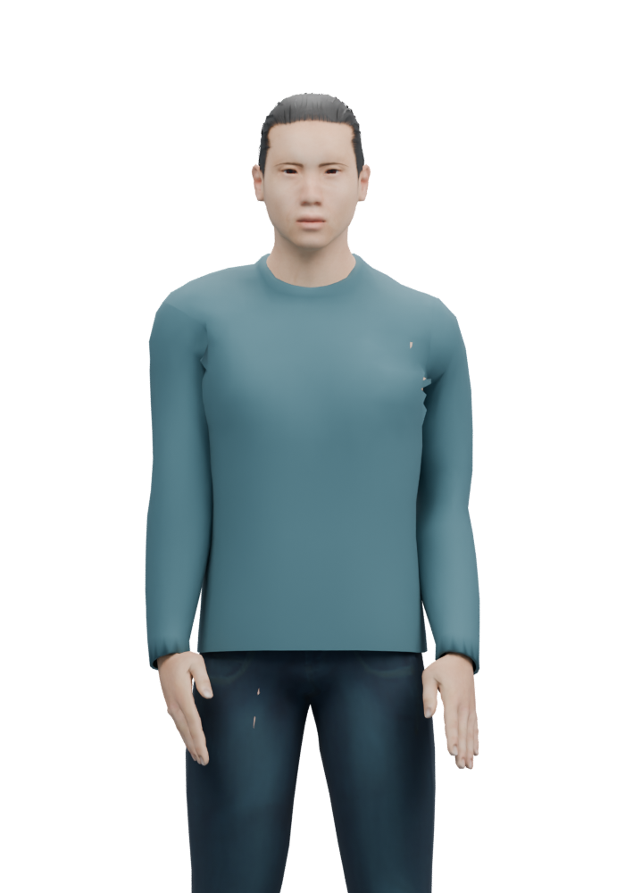
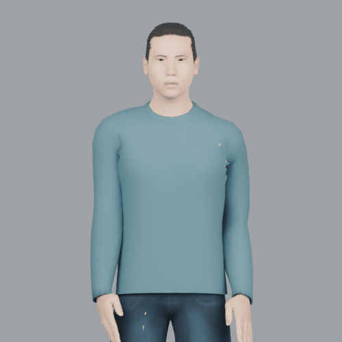
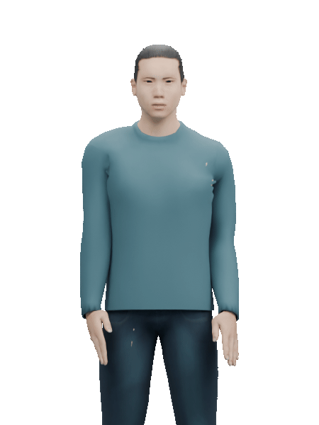
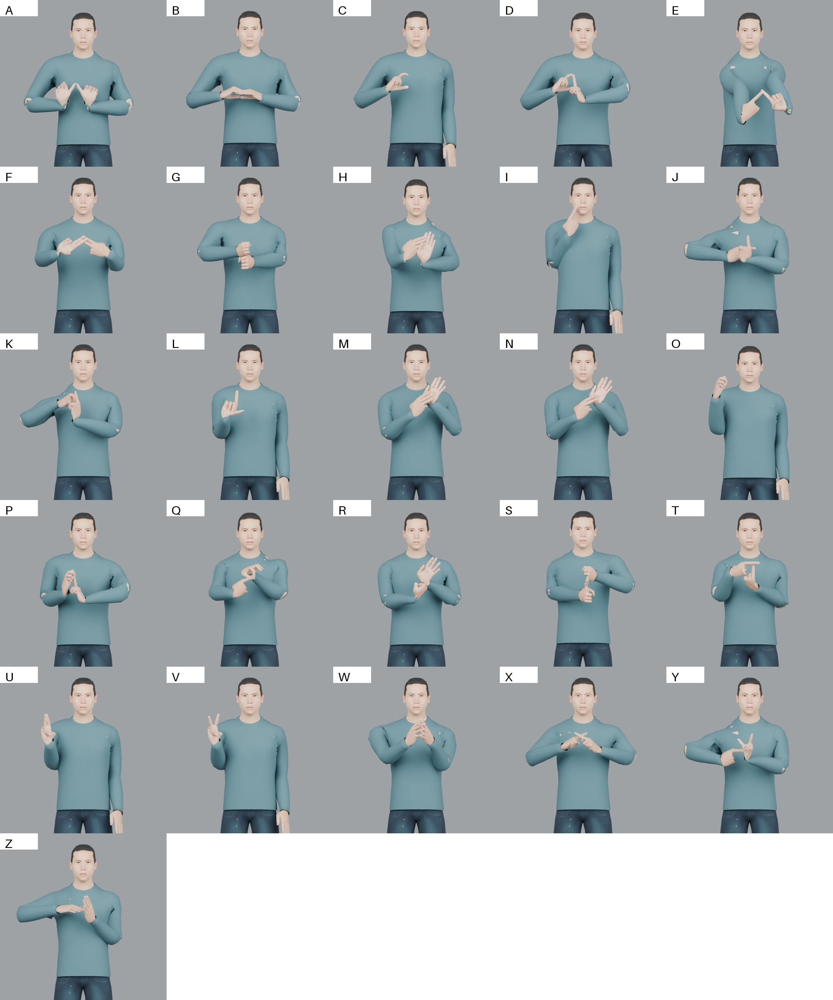

# SilentBridge

**A face-to-face communication aid between hearing people and Indian Sign Language (ISL) users.** Speech or text becomes editable captions and 3D avatar sign clips; replies can be typed or picked from a phrasebook and spoken aloud.

> This repository is a showcase only. The source code is private.

  

  
  
  

## Features

- **Hearing → deaf:** speak or type English, review it, then show large captions and play the matching avatar sign clips.
- **Deaf → hearing:** type a message or pick a phrase, show it in large text, and speak it with the device voice.
- **Phrasebook:** searchable starter phrases with favorites and recents.
- **Alphabet practice:** all 26 ISL letters on a 3D avatar, with slow and normal playback and a practice log kept on the device.
- **Works offline first:** typing, the phrasebook, captions and the bundled clips need no server.
- **Optional online processing:** opt-in text processing through a self-hosted API.
- **Optional live sign recognition:** after the signer consents, a camera session suggests single signed words (not full sentences).
- **Accessibility:** light, dark and high-contrast themes, reduced motion, caption sizing, and speech and playback speed controls.

## How it works

A small rule set reorders simple English sentences into an SOV sign-order preview. For example, “I am in college” becomes `ME COLLEGE IN`, with the full English sentence kept visible. Words without a sign clip are finger-spelled. This is a limited preview, not validated ISL grammar. The signs still await review by Deaf ISL signers.

## Architecture

| Layer | Technology |
| --- | --- |
| Mobile app | Flutter 3.35 / Dart 3.9 (Android, iOS) |
| Avatar | GLB model with 42 playable clips (26 letters, 15 words and phrases, idle), Blender pipeline |
| Backend (optional) | Python 3.12, FastAPI, request limits, versioned `/v1` API, Docker |
| Recognition (optional) | OpenHands SL-GCN model trained on the INCLUDE dataset, single-word suggestions over WebSocket |
| CI | GitHub Actions: tests, dependency audit, secret scanning, Android bundle build |

## Privacy

- Transcripts stay in memory for the current session. Preferences are stored on the device.
- Text is sent to a server only after online processing is turned on.
- Camera frames are streamed only during an explicitly consented, foreground recognition session.

## Status

SilentBridge is a communication aid, not an interpreter. Several signs are unresolved, every sign still awaits Deaf ISL review, and Play Store release work is still open.

## Team

Built as a team project by AaKaShhhhhhhhh, himanshutiwari2005 and VBsaini.
